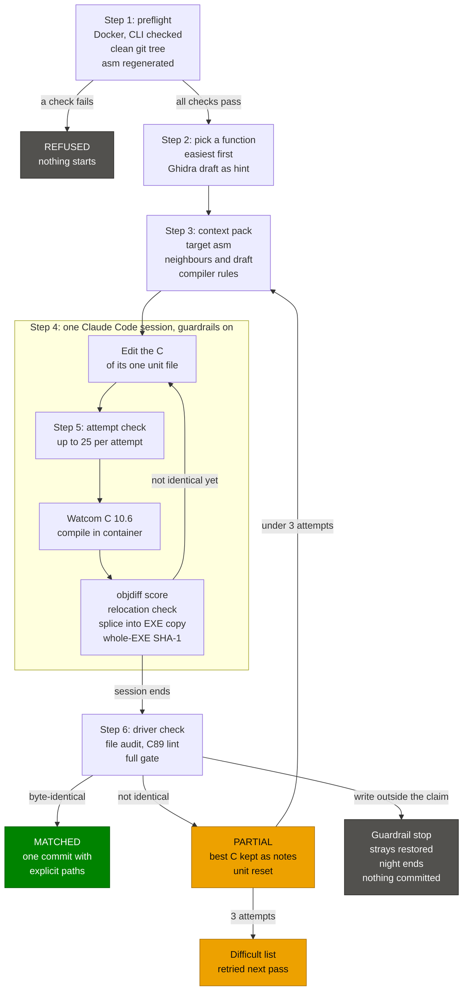

# ReverseApoc

ReverseApoc is a byte-matching decompilation of **X-COM: Apocalypse** (Mythos Games / MicroProse, 1997, DOS). The goal is readable C source that, compiled with the original Watcom toolchain, rebuilds the shipped executables byte for byte. The project exists to help the [OpenApoc](https://github.com/OpenApoc/OpenApoc) team understand the original logic, mechanics and bugs, the enemy AI in particular. It is **not** a port: there is no plan to make the game run natively on modern systems. It is also a proof of concept for AI-assisted reverse engineering with Claude Code, where every result is checked by a deterministic byte comparison.

> [!IMPORTANT]
> **This repository contains no game assets or code bytes.** No original executables, no disassembly, no data files and no compiler binaries are committed. You need your own copy of the game (Steam or GOG) and, for matching, your own copy of the Watcom compiler. Disassembly (`asm/`) and build output (`build/`) are regenerated locally from your files and are gitignored. See [docs/legal.md](docs/legal.md).

## Progress

 

The [progress page](https://ayrtondenner.github.io/ReverseApoc/) shows, for each EXE, its percent bar and a strip of one tick per game and thunk function in address order, then this mosaic.

The two badges (one per EXE, each coloured by its own percent), the mosaic, the progress page and the raw numbers ([progress.json](https://ayrtondenner.github.io/ReverseApoc/progress.json)) are regenerated on every push to `main`, together with the combined `progress-shield.json` endpoint (kept for existing consumers, not shown here) and the objdiff-shaped report.json, and published to GitHub Pages. They come from committed tables: the status tables that `reverseapoc gate` writes (`config/ufo2p/status.csv`, `config/tacp/status.csv`; never edited by hand) plus each EXE's `functions.csv` and `units.csv`. The percentage is matched bytes of game and thunk functions over all game and thunk bytes plus the uncovered bytes, per EXE and combined (thunks count as code); the combined figure comes from summed bytes, not an average. The function ratio is matched game and thunk functions over all game and thunk functions. The mosaic has one cell per function, grouped by EXE and unit and sized by bytes:

- **matched**: byte-identical to the original, proven by objdiff, the relocation check and the whole-EXE SHA-1;
- **partial**: an attempt scored above 0% in objdiff but is not byte-identical yet; it counts for nothing in the percentage or the function ratio (only report.json's fuzzy percent gives it credit);
- **unmatched**: no gate-written matched or partial row; the rebuilt EXE still carries the original bytes of the function, kept by the in-place splice;
- **library**: the Watcom runtime library, not decompiled and outside both sides of the percentage; data-in-code is excluded too;
- **uncovered**: bytes inside a unit span that no functions.csv row of any kind covers (runtime and data-in-code rows count as covering), mostly alignment filler between functions. They are in the denominator. The 3-byte tail of UFO2P's code that lies outside every unit is not counted.

Each unit with room for a label carries one: a game unit its unit name (the name its C file takes under `src/ufo2p/` or `src/tacp/`, such as `u_00089980`), a library unit the name of its largest runtime function (such as `__int7`, the FPU emulator). A name too long for its unit is cut short and ends with an ellipsis, as long as at least six of its characters still fit. Small units have none.

The same figures, per EXE, are committed for DecompHub: [Progress data](decomphub.progress.json). That file changes only when a `gate EXE/UNIT` run passes.

## How an agent session matches a function

`uv run reverseapoc drive` runs unattended matching nights. Each attempt at one function is one fresh Claude Code
session in a locked-down checkout, and nothing the session claims counts: the driver compiles and compares the bytes
itself. In plain terms, Claude writes a recipe (the C), the original compiler bakes it, and only an exact copy of the
original counts.

1. **Preflight.** Before anything starts, the driver checks that Docker answers and the build container is in sync,
   that the Claude CLI is in the tested range, and that the git tree is clean, so every later change can be traced to
   a session. It compiles the Python tooling once (sessions never write cache files) and regenerates the disassembly
   of both EXEs. Any failure is a refusal: nothing runs.
2. **Pick a function.** The picker takes small, easy functions first, alternating UFO2P and TACP, at most two per
   unit, and skips anything already matched or on the difficult list. Ghidra adds a rough C draft for each pick as a
   hint (some picks have none).
3. **Build the context pack.** One file per function with what a session needs: the target disassembly, the
   neighbouring functions, the Ghidra draft and the Watcom coding rules.
4. **One Claude Code session.** The driver starts a fresh `claude -p` session with the pack and the `watcom-decomp`
   skill. Guardrail hooks deny almost everything: the session may edit only its one unit file (for example
   `src/ufo2p/u_00089980.c`), add a header or write its notes, and it may run only three commands:
   `attempt context` (re-read the pack), `attempt asm` (read the target disassembly) and `attempt check`. A canary
   run proves the hooks deny before any night starts.
5. **`attempt check`.** Inside the container, the unit is compiled with the original Watcom C 10.6 compiler and flags
   (`-4r -s -fpi`). objdiff scores the new function against the original, a relocation check confirms every reference
   lands on the same target, and the function is spliced into a copy of your own EXE, whose SHA-1 must equal the
   retail file's. The session reads the result, edits the C (a type, the statement order, a loop's shape) and checks
   again, at most 25 times per attempt.
6. **The driver checks the work.** When the session ends, the driver audits every file it touched (a write outside
   the claim stops the night), lints the unit as C89 and runs the full gate in the container. Only the gate's exit 0
   makes a match.

| Result | What it means | What the driver does |
|---|---|---|
| **MATCHED** | The C compiles to the original bytes: objdiff 100%, the relocations agree, and the spliced EXE keeps the retail SHA-1. | One commit with explicit paths (the unit, `status.csv`, `decomphub.progress.json`, `progress/attempts.jsonl`), marked `Matched-By: reverseapoc drive`. It counts in the progress figures. |
| **PARTIAL** | The C scores above 0% in objdiff but is not byte-identical yet. | The best C is kept under `build/` with its score, the unit is reset, and the function goes back in the queue. After 3 attempts it moves to the difficult list for a later pass. It counts for nothing in the percentage. |

On the first pilot night (run `20261026-005209`), 40 sessions gave 3 MATCHED and 37 PARTIAL; the closest partials
reached 87.5% and 87.2%. At the end of every night the driver rebuilds both EXEs, checks their SHA-1s and re-runs the
gate on every match before it commits the attempt log.

Details (flags, the refusal reasons, the canary, reset rules and the console): [docs/workflow.md](docs/workflow.md#running-the-driver).

## Supported versions

Only the DOS release is supported. Steam and GOG ship byte-identical game executables, so either store works (Steam is preferred, GOG is the fallback).

| File | Role | Size (bytes) | md5 | Scope |
|---|---|---:|---|---|
| `UFOEXE/UFO2P.EXE` | Main game program, module `ufo24` | 1,705,790 | `d2e874a76344cb9c48afce57357aab31` | Target |
| `TACEXE/TACP.EXE` | Tactical program, module `tac4` | 3,161,594 | `644382a6caa787cff613c50a170b5152` | Target |
| `UFOEXE/SMKP.EXE` | Smacker video player | 271,436 | `2d7933f255348a60536d811391b461ba` | Deferred |
| `XCOMAPOC.EXE` | 16-bit launcher | 18,171 | `867f7997fae1714313b873f15359c4fb` | Out of scope |

SHA-1 values go into the hash manifest in Phase 2. `SETUP.EXE` (Borland C++, 1991) is out of scope. The disc image that both stores ship (`cd.iso` on Steam, `CD/XCOM.BIN` on GOG, byte-identical) contains the original v1.00 builds: UFO2P.EXE 1,702,206 bytes with CRC32 `0x4749FFC1`, the value OpenApoc's extractors expect, and TACP.EXE 3,170,298 bytes. The installed files above are a later build. OpenApoc reads from the disc image, so its offsets describe the CD build; this project targets the installed build first and records both ([docs/toolchain.md](docs/toolchain.md#openapoc-crc-mismatch-resolved-2026-10-19)).

A Windows 95 release also existed. On what it contains, OpenApoc community member FilmBoy84 recalls:

> Yeah, IIRC the Win9x version is just an installer wrapper. Game beneath is identical and just uses DOS 7.x that's part of Win9x instead of DOS 6.2x that was the last packaged version of MS-DOS
>
> (OpenApoc Discord, [FilmBoy84](https://discord.com/users/383602459076984835), 2026-10-15, [message link](https://discord.com/channels/142798944970211328/691788237865353236/1560376052843413545))

This is a recollection, not a verified fact. Hashing a retail Win9x executable against the DOS one is welcome future work.

## Approach

ReverseApoc uses a **hybrid solution**: our own matching oracle, plus decomp.wtf's "fork mode" as the agent layer. (Phase 6 update: spike 006 INVALIDATED fork mode (plan 06-01), so the agent layer is our own (D-03, D-04); see the notes below.)

The oracle (ours, assembled from reusable parts):

- The original Watcom C 10.x `wcc386`, supplied by you, runs under [wibo](https://github.com/decompals/wibo) inside a Docker image.
- A Python `configure.py` generates a [ninja](https://ninja-build.org/) build with per-file compiler flags.
- A Python LE splitter reads the executables. Matched functions are spliced in place into a copy of the original EXE, and a whole-EXE SHA-1 check gates every build. The DOS/4GW Professional kernel stays an opaque blob taken from your own file.
- An OMF-to-ELF converter lets [objdiff](https://github.com/encounter/objdiff) diff Watcom objects and produce progress reports.

The agent layer:

- [decomp.wtf](https://github.com/i12bp8/decomp.wtf) v0.10.6 in fork mode, pinned and lightly patched, installed in WSL2 and run as a separate tool (a subprocess, never imported). Fork mode accepts a local repo that builds with `configure.py` + ninja and produces `objdiff.json`. It judges candidates with objdiff and brings function claims, MCP tools, guardrails and a dashboard. (Not used in Phase 6: spike 006 INVALIDATED fork mode (06-01). The agent layer is our own (D-03, D-04), with no MCP server (D-44); agents call the Bash-allowlisted attempt wrapper. decomp.wtf is re-evaluated for Phase 7.)
- Our driver re-verifies the bytes before any commit. An agent never judges its own match.
- If objdiff cannot diff the converted objects cleanly (a Phase 5 spike), the fallback is our own minimal agent layer: an MCP server, claims and guardrails, Claude Code only. (Phase 6 update: objdiff diffs the converted objects (spike 005 VALIDATED), but spike 006 INVALIDATED fork mode, so Phase 6 builds its own agent layer anyway: the driver, the guardrail hooks and the context pack, with no MCP server (D-44); agents call the Bash-allowlisted attempt wrapper.)

The order of work follows Abahbob's rule: get a byte-identical rebuild of raw bytes first, decompile second.

### Projects we build on

| Project | License | What we use |
|---|---|---|
| [KKND-Decomp](https://github.com/Wyrelade/KKND-Decomp) | CC0-1.0 | LE reader, in-place page splice with SHA-1 gate, function discovery tools |
| [Theme Hospital decomp](https://github.com/matteo-pacini/theme-hospital-decomp) | GPLv3 | `omf2elf.py`, the `configure.py` + ninja + objdiff pattern; the reference for a 100% matched Watcom 10.6 DOS/4GW game |
| [retrokit](https://github.com/nemo22/retrokit) | Apache-2.0 | Headless Ghidra LE loader, Watcom calling conventions, function export, MCP server (external tool) (not used: Phase 5 runs Ghidra headless in the Docker image with the lastonesky loader) |
| [decomp.wtf](https://github.com/i12bp8/decomp.wtf) | MIT (archived 2026-10-15) | Agent harness, claims, guardrails, dashboard; used in fork mode as a separate tool (not used in Phase 6: spike 006 INVALIDATED fork mode; the agent layer is our own, D-03/D-04) |

Files copied from Theme Hospital keep their copyright headers. That is why `tools/` is GPLv3.

## Toolchain summary

- **Compiler:** Watcom C 10.6 `wcc386` (C, not C++) under the default rule `-4r -s -fpi`. The runtime library is 10.6 byte for byte; on game code 10.5, 10.6 and 11.0 stay tied after the two Phase 5 leaf matches, and later matches are logged to separate them (see docs/toolchain.md).
- **Extender:** DOS/4GW Professional, bound into each EXE (LE format, two objects, no debug info).
- **Analysis:** Ghidra 12.1.4 with the lastonesky [ghidra-lx-loader](https://github.com/lastonesky/ghidra-lx-loader), headless in the Docker image.
- **Diff and reports:** objdiff, behind an OMF-to-ELF converter.
- **Tooling:** Python 3.14 with [uv](https://docs.astral.sh/uv/), everything build-related in Docker.

Details, evidence and pinned versions: [docs/toolchain.md](docs/toolchain.md).

## Getting started

Bring your own files. Nothing below downloads the game, and the compiler download is a separate opt-in command (see the end of this section).

1. Copy `.env.example` to `.env` and point `APOC_STEAM_FOLDER` (or `APOC_GOG_FOLDER`) at your install.
2. `uv run reverseapoc ingest` copies the executables into the gitignored `orig/` and checks their hashes.
3. `docker compose build`
4. `docker compose run --rm build uv run pytest`
5. `git config core.hooksPath .githooks` enables the tracked `commit-msg` hook, which adds a `Co-Authored-By` trailer to commits made under Claude Code (including GSD's own commits and merges). Override the value with `git config reverseapoc.coauthor "Name <email>"`.

`docker compose run --rm test` runs the test suite in the container in one step. To get the original Watcom compilers, run `uv run reverseapoc fetch-watcom` and then `uv run reverseapoc install-watcom` (opt-in, at your own responsibility); they land in the gitignored `third_party/watcom/`. Sources and details: [Getting the Watcom compilers](docs/toolchain.md#getting-the-watcom-compilers).

## Workflow and ceremonies

- [docs/workflow.md](docs/workflow.md): the per-function loop, the guardrails and the Milestone 1 roadmap.
- [docs/ceremonies.md](docs/ceremonies.md): which review, simplify and comment passes run on Python tooling and which may touch matched C.
- [GSD](https://github.com/open-gsd/gsd-core) structures milestones and phases (discuss, plan, execute, verify). [superpowers](https://github.com/obra/superpowers) drives the work inside a phase (brainstorming, TDD on tooling, verification before completion).
- Coding rules: [docs/coding-style.md](docs/coding-style.md). Matching notes: [docs/matching.md](docs/matching.md). Journal: [docs/learnings.md](docs/learnings.md). Design: [docs/superpowers/specs/2026-10-19-reverseapoc-design.md](docs/superpowers/specs/2026-10-19-reverseapoc-design.md). Research: [docs/research/](docs/research/).

## Sources and motivation

| Date | Author | Post |
|---|---|---|
| Feb 2023 | Abahbob | [Starting a decomp project](https://abahbob.com/starting-a-decomp-project) |
| 2025-05-20 (archive date) | Macabeus | [Development Journey on Game Decompilation Using AI](https://gambiconf.substack.com/p/development-journey-on-game-decompilation) |
| 2025-05-20 | Macabeus | [Using AI for Matching Decompilation of an Entire Module](https://gambiconf.substack.com/p/development-journey-on-game-decompilation-841) |
| 2025-07-26 | Macabeus | [Building an AI-Powered VS Code Extension for Decompilation](https://gambiconf.substack.com/p/development-journey-on-game-decompilation-808) |
| 2025-11-04 | Chris Lewis | [Using Coding Agents to Decompile Nintendo 64 Games](https://blog.chrislewis.au/using-coding-agents-to-decompile-nintendo-64-games/) |
| 2025-11-27 | Chris Lewis | [The Unexpected Effectiveness of One-Shot Decompilation with Claude](https://blog.chrislewis.au/the-unexpected-effectiveness-of-one-shot-decompilation-with-claude/) |
| 2025-12-06 | Simon Willison | [Summary of Lewis's one-shot work](https://simonwillison.net/2025/Dec/6/one-shot-decompilation/) |
| 2025-12-23 | Chris Lewis | Finding Jingle Town: Debugging an N64 Game without Symbols ([blog index](https://blog.chrislewis.au/)) |
| 2026-02-16 | Chris Lewis | [The Long Tail of LLM-Assisted Decompilation](https://blog.chrislewis.au/the-long-tail-of-llm-assisted-decompilation/) |
| 2026-03-10 | Macabeus | [Can LLMs Really Do Matching Decompilation? I Tested 60 Functions](https://gambiconf.substack.com/p/can-llms-really-do-matching-decompilation) |
| 2026-05-17 | Chris Lewis | Snowboard Kids 2 is 100% Decompiled ([blog index](https://blog.chrislewis.au/)) |
| 2026-06-21 | Chris Lewis | Snowboard Kids 2 is Recompiled ([blog index](https://blog.chrislewis.au/)) |
| 2026-07-07 | Macabeus | [Fable 5: Does the smartest LLM decompile better?](https://gambiconf.substack.com/p/fable-5-does-the-smartest-llm-decompile) |
| 2026-08-17 | Macabeus | [Starting a Decompilation Project from Zero: Claude Code and 51% of a 2001 GBA Game](https://gambiconf.substack.com/p/starting-a-decompilation-project) |
| 2026-08-26 | Chris Lewis | [Decompiling a Nintendo 64 Game in 84 Days](https://blog.chrislewis.au/decompiling-a-nintendo-64-game-in-84-days/) |
| 2026-10-02 | Chris Lewis | Introducing Snowboard Kids: Recompiled ([blog index](https://blog.chrislewis.au/)) |

The Substack archive gives the same date for Macabeus's first two chapters, so chapter 1 may be older.

## Reference repositories

- [AnyPS5](https://github.com/boykopovar/AnyPS5): README layout, progress mosaic and badge pattern (a porting tool, not a decomp).
- [sm64](https://github.com/n64decomp/sm64) and [pokered](https://github.com/pret/pokered): SHA-1 tables and the bring-your-own-files convention.
- [augustus](https://github.com/Keriew/augustus): a reimplementation of Caesar III, not a decomp; README structure only.
- [awesome-game-decompilations](https://github.com/CharlotteCross1998/awesome-game-decompilations), [awesome-decomp-games](https://github.com/SubmitGame/awesome-decomp-games) and PCGamingWiki's [list of unofficial ports](https://www.pcgamingwiki.com/wiki/List_of_unofficial_ports): where to look for comparable projects.
- [NHL95PC](https://github.com/abdulahmad/NHL95PC): Watcom 10.0 DOS game, compiler pinned by library matching.
- [Blood-RE](https://github.com/NBlood/Blood-RE): matching decomp built with Watcom 10.6 and TASM 3.1.
- [f15se2-re](https://github.com/neuviemeporte/f15se2-re): F-15 Strike Eagle II, the only MicroProse DOS reconstruction found (Microsoft C 5.1).
- [OpenApoc](https://github.com/OpenApoc/OpenApoc): the reimplementation this project serves.
- [OpenXcom](https://github.com/OpenXcom/OpenXcom): reimplementation of UFO: Enemy Unknown and Terror from the Deep, not Apocalypse.

No Watcom matching decomp of an X-COM title turned up in the lists searched. ReverseApoc is the closest found, not a claimed first.

## Tools and skills

Verdicts in short; the full table with reasons, install method and status is in [docs/tools.md](docs/tools.md).

| Area | Use | Later | Skip |
|---|---|---|---|
| Analysis | [Ghidra](https://github.com/NationalSecurityAgency/ghidra), [GhidraMCP](https://github.com/LaurieWired/GhidraMCP) (Later) | [REA](https://github.com/morluto/rea) | [BSim](https://ghidra.re/ghidra_docs/GhidraClass/BSim/README.html) |
| Diff and matching | [objdiff](https://github.com/encounter/objdiff) | [coddog](https://github.com/ethteck/coddog) (idea reimplemented now), [mizuchi](https://github.com/macabeus/mizuchi), [decomp_settings](https://github.com/ethteck/decomp_settings) | [m2c](https://github.com/matt-kempster/m2c), [decomp-permuter](https://github.com/simonlindholm/decomp-permuter), [asm-differ](https://github.com/simonlindholm/asm-differ), [Kappa](https://github.com/macabeus/kappa) (two ideas ported) |
| C source tools | [ast-grep](https://ast-grep.github.io/), [clang-format](https://clang.llvm.org/docs/ClangFormat.html) | | |
| Loops | [Nigel](https://github.com/cdlewis/nigel), [/goal](https://code.claude.com/docs/en/goal), [autoresearch](https://github.com/karpathy/autoresearch) (pattern) | [Ralph loop](https://github.com/anthropics/claude-plugins-official/tree/main/plugins/ralph-loop) (prototype) | [Bilevel-Autoresearch](https://github.com/EdwardOptimization/Bilevel-Autoresearch) |
| Planning | [GSD](https://github.com/open-gsd/gsd-core), [superpowers](https://github.com/obra/superpowers), [OpenSpec](https://github.com/Fission-AI/openspec) spec format (Phase 8) | | OpenSpec tool, [SpecKit](https://github.com/github/spec-kit) |
| Understanding | | [Understand-Anything](https://github.com/Egonex-AI/Understand-Anything), [Groma](https://github.com/MrLesk/groma.md) | |
| Style and review | [i-have-adhd](https://github.com/ayghri/i-have-adhd) (chat and comments) | | [Ponytail](https://github.com/dietrichgebert/ponytail), [pstack](https://github.com/backnotprop/pstack), [thermo-nuclear review](https://github.com/cursor/plugins/blob/main/cursor-team-kit/skills/thermo-nuclear-code-quality-review/SKILL.md), [cpp-pro](https://github.com/sickn33/agentic-awesome-skills/blob/main/skills/cpp-pro/SKILL.md), [Mindrally cpp](https://github.com/Mindrally/skills/blob/main/cpp/SKILL.md), [Qt agent-skills](https://github.com/TheQtCompanyRnD/agent-skills) |
| Retrieval | | [jina embeddings](https://huggingface.co/jinaai/jina-embeddings-v2-base-code), [Voyage](https://blog.voyageai.com/2026/08/13/voyage-code-4/) (optional), SQLite + numpy | [pgvector](https://github.com/pgvector/pgvector), [RxDB](https://rxdb.info/) |

## Directories and tracking

- [recomp.fyi](https://recomp.fyi/): listed through a `.recomp.json` at the repo root; it reads an objdiff `report.json` artifact daily for the percentage.
- [decomphub.com](https://decomphub.com/): submitted through its reviewed form at <https://app.decomphub.com/submit> once the repo is public (no file format, no badge).
- [decomp.dev](https://decomp.dev/): closed to new projects in October 2026, so progress is self-hosted on GitHub Pages.
- [Decompedia](https://decomp.wiki/): community wiki on decompilation, a place to be listed later.
- [decomp.me](https://decomp.me/): shareable scratches for hard functions (it has `wcc10.5`, `wcc10.6` and `wcc11.0`). Used sparingly; we do not flood it with agent scratches.

## AI use

AI tools, Claude Code in particular, are used openly in this project, from research to decompilation attempts. No AI output is trusted on its own: every match is verified by byte comparison (objdiff, relocation checks and the whole-EXE SHA-1) run by the build, not by the agent. Prior reverse engineering by the OpenApoc community (its data extractors and ongoing Ghidra-based work) is credited wherever it is reused.

## License

The tooling under `tools/` is GPLv3, because it includes modules from the Theme Hospital decomp with their headers kept. The decompiled C under `src/` reproduces copyrighted game logic for interoperability and research and is published to support OpenApoc; no rights in it are claimed and no assets ship with it. The behaviour specs under `specs/` (Phase 8) are CC0-1.0, written in our own words for clean-room reimplementation; see [docs/clean-room.md](docs/clean-room.md). See [docs/legal.md](docs/legal.md).

## Contributing

Use [GitHub issues](https://github.com/ayrtondenner/ReverseApoc/issues) for bugs, questions and proposals. Please never attach game files, executables or disassembly to an issue or pull request.
