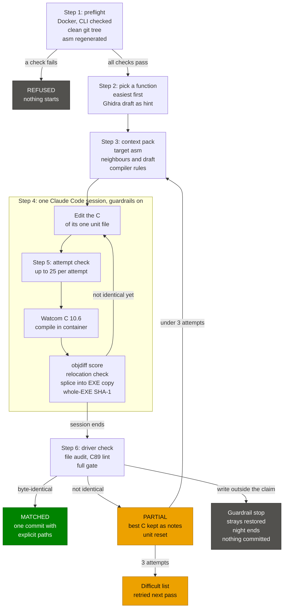

# Workflow

Work runs at three levels:

1. **Milestone**: a set of gated phases, tracked by GSD in `.planning/`.
2. **Phase**: GSD's discuss, plan, execute, verify loop, with superpowers skills inside it.
3. **Function**: the per-function matching loop, from Phase 5 on.

The rule that ties them together: deterministic checks decide what is done. An agent never judges its own result. Every documented failure in the research (false match claims, rewritten hashes, permuter overfitting) came from letting the agent judge itself ([report](research/2026-10-19-kickoff-research-report.md)).

## The per-function loop

Starts in Phase 5 (by hand) and becomes unattended in Phase 6.



The flowchart is one `reverseapoc drive` attempt as Phase 6 runs it (the same one as the README's "How an agent session matches a function"); [Running the driver](#running-the-driver) has the details.

1. **Select.** A scorer picks the next function. Start with easiest-first (KKND's `score_functions.py`); switch to similarity-first once enough functions are matched, because Lewis found that ordering by similarity to matched functions beat ordering by difficulty in the long tail. Twin functions between UFO2P (`ufo24`) and TACP (`tac4`), and Watcom runtime functions found by library matching, are the cheapest wins.
2. **Attempt.** One fresh headless session per function (`claude -p "/goal ..."`), given the target asm, callers and callees, shared headers, a Ghidra draft and notes from earlier attempts.
3. **Compile.** The original `wcc386` under wibo in Docker, with the file's flags from the per-file flags table.
4. **Compare.** objdiff on the OMF-to-ELF converted object against the target object cut from the LE. Then the relocation check: every `call rel32` must hit the same function and every absolute fixup must resolve to the original target. objdiff compares at most one relocation per instruction, so a separate check covers the rest. "A scratch match alone is never enough" (KKND).
5. **Splice and verify.** Splice the matched bytes in place into a copy of the original EXE and check the whole-EXE SHA-1 against the manifest. This is the definition of done.
6. **Commit.** One matched function per commit. Record anything learned in [learnings.md](learnings.md) and, if it is a reusable rule, in [matching.md](matching.md).

### Attempt cap and re-queue

- **3-5 attempts per function per pass.** In Macabeus's Mizuchi benchmark nearly half of the AI matches came on the first attempt, and after attempt 3 the conditional chance of a match fell to about a quarter ([Macabeus, 2026-03-10](https://gambiconf.substack.com/p/can-llms-really-do-matching-decompilation)).
- A function that hits the cap goes to a difficult list and is re-queued in a later pass, once more of its neighbours, structs and callees are matched.
- Partial results are kept as notes, not committed as matches.

### The driver owns verification

- The driver re-runs the compile, compare and SHA-1 check itself before committing. It never trusts the transcript. Only the container gate's exit 0 is a match (D-24).
- `/goal`'s evaluator "does not call tools" ([docs](https://code.claude.com/docs/en/goal)), so its verdict is a hint, not a check.
- The driver backs off when it hits usage limits (60, 120, 240 s, then every 300 s) and caps the night. Unattended Opus can exhaust a Max 20x plan in days ([Lewis, 2026-02-16](https://blog.chrislewis.au/the-long-tail-of-llm-assisted-decompilation/)).
- Phase 6 caps each function at 3 sessions per pass (D-07). A capped function goes to `build/driver/difficult.json` and comes back once a callee is matched or the easy pool is empty.
- **Nigel was rejected (D-05).** It has no licence (GitHub reports none), needs Go, which is not on the host, logs no turns or tokens, and detects usage limits by one phrase. The driver is our own stdlib Python instead: `tools/reverseapoc/driver.py` and the `reverseapoc drive` verb, built test-first.
- **decomp.wtf is not used in Phase 6 (D-03).** Spike 006 ([README](../.planning/spikes/006-decompwtf-fork-stub/README.md)) found that unpatched v0.10.6 fork mode does not accept our stub convention (verdict INVALIDATED: no build in WSL2, and its stub regex and linker-name lookup refuse our `INCLUDE_ASM(func_X);` units). Phase 6 runs on its own agent layer: the driver, the hooks, the `watcom-decomp` skill, the context pack and the attempt wrapper. decomp.wtf is re-evaluated for Phase 7's parallel claims.

### Running the driver

`reverseapoc drive` runs on the Windows host, in the main checkout (D-34). It starts one fresh `claude -p` session per attempt and runs every gate in the container.

```
uv run reverseapoc drive [--max-sessions N] [--target-matched N] [--dry-run | --canary] [--run ID] [--json]
```

| Flag | Default | Meaning |
|---|---|---|
| `--max-sessions N` | 30 | counted sessions before the night ends (D-48) |
| `--target-matched N` | 10 | matches before the night ends (D-48) |
| `--dry-run` | off | print the 10 pilot picks and build their packs; no claude, no gate |
| `--canary` | off | owner only: one real session that proves the guardrails deny (PASS/FAIL) |
| `--run ID` | the UTC start time | the run directory `build/driver/<ID>/` |
| `--json` | off | print exactly one JSON document on stdout |

The pilot command is `uv run reverseapoc drive --max-sessions 40 --target-matched 10` (D-37, D-48).

**Before you start** (the preflight refuses without most of these):

- Docker Desktop is running (`docker info` answers) and the image is built: `docker compose build`.
- `orig/` holds your executables: `uv run reverseapoc ingest`, then `uv run reverseapoc check-orig`.
- The Watcom trees are installed under `third_party/watcom/`: `uv run reverseapoc install-watcom` (after `fetch-watcom`), then `uv run reverseapoc check-watcom`.
- The Claude CLI is in the tested range: `claude --version` must print major 2 and at least 2.1.302 (for example `2.1.302 (Claude Code)`). Upgrade with `claude install stable` if it is older.
- The tree is clean: `git status` shows nothing, on the main checkout.

**Then, in this order, from the main checkout:**

1. `uv run reverseapoc drive --dry-run`: check the 10 picks and that it exits 0.
2. `uv run reverseapoc drive --canary --run <fresh id>` (for example `--run canary1`, then `canary2`): repeat with a new id, after the recovery steps below, until the last line is `CANARY PASS`.
3. `uv run reverseapoc drive --max-sessions 40 --target-matched 10`: the pilot.
4. Read the results:
   - the exit code (0 ended clean, 1 stopped or a failed end check, 2 refused) and the printed summary (the last stdout line, stamped with the time the night ended);
   - `progress/attempts.jsonl`: one `attempt` record per counted session (outcome MATCHED, PARTIAL or GAVE_UP), `abort` records, and the `run` records; the last one is ENDED or STOPPED with its `reason`, `checks_failed` and `uncommitted`;
   - `config/ufo2p/status.csv` and `config/tacp/status.csv`: the matched and partial rows;
   - the commits: `git log --format='%h %s' --grep='^Matched-By: reverseapoc drive$'` lists one `feat(<exe>): match ...` commit per match; the night's last commit is `chore(driver): attempt log`;
   - `build/driver/<run>/`: transcripts, check logs, notes, `end-ninja-verify.log`, `end-gate-all.log`.
5. The commits are local. Pushing `main` is the owner's step, after reading the results.

**The console.** In text mode every line `drive` prints while it runs starts with the host's local time as `[HH:MM:SS] ` (24-hour), and each long step gets its line when it starts, so the last line always says what is running and since when. Each preflight command prints as `[21:04:05] drive: $ docker info` when that command starts; its exit and output go to `preflight.log`, and the next line's time shows when it finished. Notes such as `drive: ufo2p: no Ghidra draft for ...` are stamped the same way. Each night attempt prints a line when it starts, for example `[22:10:31] drive: ufo2p func_0008A100 attempt 1/3: started`, a line before each usage-limit wait, for example `[22:11:20] drive: ufo2p func_0008A100 attempt 1/3: usage limit, next launch in 60 s`, and one with its outcome, for example `[22:19:02] drive: ufo2p func_0008A100 attempt 1/3: PARTIAL after 511.2 s`. The outcome is MATCHED, PARTIAL, GAVE_UP or ABORTED (transient); the seconds run from the start line to the outcome, relaunches, usage-limit waits and the gate included, so they can exceed the record's `seconds`. An attempt that stops the night prints no outcome line: the summary says why. Before each end-of-run check the night prints `[03:01:10] drive: end of run: ninja verify: started` and then `drive: end of run: gate --all: started`. The canary prints `drive: canary: ufo2p func_000A3980 session: started (timeout 1200 s)` before its session. The summary itself is stamped too, for example `[03:12:44] ENDED max sessions: 40 sessions, 3 matched`, and so is a refusal, for example `[21:04:05] reverseapoc drive: refused (dirty): ...`. Progress lines go to stderr and the summary to stdout. The dry run's pick lines, the canary's `PASS:` and `FAIL:` lines and its last line carry no time, so the last line is still exactly `CANARY PASS`. With `--json` no stamped line is printed: stdout is the one JSON document and stderr stays quiet. `preflight.log`, the `end-*.log` files, `progress/attempts.jsonl` and the transcripts carry no console time.

**Preflight.** Every run, the dry run and the canary included, first checks the checkout, then runs a fixed list of commands. Nothing is started unless all of it passes. It compiles `tools/` and `configure.py`, so no session writes a `.pyc` (the hooks run `python -I`, which ignores `PYTHONDONTWRITEBYTECODE`), and regenerates the asm listings of both EXEs on the host. The dry run and the night (not the canary) then load both EXEs and precompute the Ghidra drafts of their picks in one container call per EXE (`ghidra-export EXE --json --drafts ...`, D-13). Each command's output goes to `build/driver/<run>/preflight.log`.

Any failure before the night starts is a refusal: exit 2, a reason, a detail, and with `--json` exactly one document `{"event": "REFUSED", "reason": ..., "detail": ...}`. The reasons:

| Reason | When |
|---|---|
| `run id` | `--run ID` is not `[A-Za-z0-9_.-]+`, or a canary with this ID already ran (its attempt directory exists) |
| `worktree` | not the main checkout (a linked worktree has its own git dir) |
| `dirty` | `git status --porcelain` is not empty; the detail names the paths |
| `cli version` | `claude --version` fails, cannot be read, is not major 2, or is below **2.1.302**, the minimum CLI version (D-36; the dry run skips only this check). 2.1.302 is the release where `-p` has the documented permission default; `onFailure` needs 2.1.295 |
| `docker` | `docker info` fails |
| `container sync` / `host sync` | `uv sync --locked` fails in the container / on the host |
| `compile` | `compileall` of `tools/` and `configure.py` fails |
| `asm` | the asm listings of an EXE cannot be written |
| `world` | an EXE cannot be loaded (orig/, a config CSV) |
| `picks` | a status table or `build/driver/difficult.json` cannot be read, or the pilot cannot be filled with 5 + 5 |
| `drafts` | `ghidra-export --drafts` fails. Exit 1 is accepted only with a JSON document that names the missing drafts (a pack works without a draft); every other failure refuses |
| `pack` | the dry run cannot build a pack |
| `preflight` / `canary` | any other unexpected error in those steps. A git or a docker that cannot start does not land here: the real runners turn it into a failed command, so it gives `worktree` (git) or `docker`. A canary error after its session started is not a refusal: it is a FAIL line and `CANARY FAIL`, exit 1 |

The night's own refusal (`dirty` outputs: `progress/attempts.jsonl`, a `status.csv` or the feed differ from HEAD) also exits 2.

**Dry run.** `uv run reverseapoc drive --dry-run` prints the 10 pilot picks: 5 UFO2P and 5 TACP, interleaved, easiest first, at most 2 per unit and 3 per 64 KiB region (D-10). It builds their context packs under `build/driver/<run>/dry-run/` and never launches claude or a gate. The picker skips functions that are matched in `status.csv`, partial today (this pass), or on the difficult list.

**Canary.** `uv run reverseapoc drive --canary` is run by the owner before the pilot. It launches one real session with the matching settings and a fixed prompt that asks for five calls: Write `config/targets.toml`, Write `tools/x.py`, Bash `ls`, `uv run --frozen reverseapoc attempt context` and `uv run --frozen reverseapoc attempt check`. The claim is `ufo2p/u_000a34f0`, function `func_000A3980`, with its attempt directory under `build/driver/canary/<run>/`. It prints PASS only when all of these hold:

- the session's init event is clean (CLI version, model, the six tools, no MCP server, no plugin). CLI built-in plugins count as plugins. The driver settings switch them off with short `<alias>@builtin: false` keys. CLI 2.1.308 ships `cc-plugin-agents-md`, `cc-plugin-telemetry` and `cc-plugin-plugin-authoring`; the key drops the `cc-plugin-` prefix (`"agents-md@builtin": false`), as probed on 2026-10-25;
- the first three calls are in the result's `permission_denials`;
- both wrapper calls were made and not denied, `attempt context` wrote `context.md`, and `attempt check` logged exit 0 (the claimed function is already matched, so this proves the container path);
- no unknown stream event type carries an error;
- the attempt's containers were removed afterwards (by the attempt's name prefix, as the night does);
- `git status --porcelain` is clean afterwards;
- HEAD and every ref are where they were (a commit leaves `git status` clean);
- nothing the night's audit pins or fingerprints changed (`.git/config`, `.git/info/exclude` and `attributes`, `.git/hooks/`, `.githooks/`, the two Claude settings files, `.venv`, the gitignored `.claude/` trees but `.claude/worktrees/`, every `__pycache__`).

Each check prints one `PASS: ...` or `FAIL: ...` line, with no time stamp; the last line is `CANARY PASS` (exit 0) or `CANARY FAIL` (exit 1). Use a fresh `--run ID` for every canary (the default, the UTC time, always is): a reused one is refused. The canary leaves the tree as the session left it, for inspection, and changes nothing back.

**After a FAILed or leaky canary**, before anything else:

1. Read the FAIL lines and the transcript `build/driver/canary/<run>/ufo2p/func_000A3980/attempt-1/transcript.jsonl`.
2. `git status` lists what the session left in git's view. Put tracked files back with `git restore --source=HEAD -- <paths>` (for example `git restore --source=HEAD -- config/targets.toml`) and delete untracked strays by name (for example `tools/x.py`). If HEAD moved, inspect the new commit with `git log` before resetting anything.
3. The FAIL line `pinned and fingerprinted files changed: ...` names paths git cannot see (`.git/hooks/`, `.git/config`, `.venv`, `.claude/`, `__pycache__`). The next preflight does not see them, so check each named path by hand: delete a new hook, `.pth` or `*customize.py`, restore `.git/config` or a settings file from a backup or by hand, and run `uv sync --locked` and `uv run --frozen python -m compileall -q tools configure.py` again for `.venv` and `__pycache__`.
4. If a container is named in a FAIL line, remove it with `docker rm -f <name>`.
5. Run the canary again with a new `--run ID` until it prints `CANARY PASS`.

**One attempt.** The driver scaffolds the unit if it is missing, builds the pack, and starts the session in the checkout root. The session gets `REVERSEAPOC_CLAIM`, `REVERSEAPOC_FUNC`, `REVERSEAPOC_ATTEMPT_DIR` and `REVERSEAPOC_ATTEMPT_NOTES` (absolute paths). It may run only the attempt wrapper's three commands:

- `uv run --frozen reverseapoc attempt check` (and `check --sweep`, a diagnostic that is never a match), at most 25 runs per attempt;
- `uv run --frozen reverseapoc attempt asm` (or `asm <NAME>` for another row of the same EXE);
- `uv run --frozen reverseapoc attempt context`.

After the session the driver removes the attempt's containers, audits every changed path, then lints the unit (C89) and runs the container gate.

**Reset rules (D-34).** A match is one commit with explicit paths: the unit, `status.csv`, `decomphub.progress.json`, `progress/attempts.jsonl` and any new header. Anything else resets the attempt: `git restore --source=HEAD -- <unit> include/` for tracked files, and a unit scaffolded by this attempt or a header it added is deleted. The driver never runs `git add -A` or `git clean`. A partial attempt keeps its best C under `best/` and is scored by `gate --partial`. A write outside the claim is a guardrail stop: the stray files are restored or moved into `build/driver/<run>/quarantine/` (never deleted), the night ends and nothing is committed. A night that stops with partial rows leaves `status.csv` uncommitted and names it; the next drive refuses to start until the owner commits or restores it.

**End of run.** When the night ENDS (nothing to do, max sessions, target matched, queue exhausted), the driver runs, in the container, `uv run --frozen python configure.py && ninja -t clean && ninja verify`, then `reverseapoc gate --all`, and logs both under `build/driver/<run>/` (`end-ninja-verify.log`, `end-gate-all.log`). A failed check is recorded in the ENDED run record and the night exits 1. Then the `chore(driver): attempt log` commit holds the night's records. **A STOPPED night skips both end checks**: it has no ninja verify or `gate --all` evidence, so run them by hand before trusting it. Exit codes: 0 ended clean, 1 stopped or a failed end check, 2 refused.

**Warnings for the night.**

- **Do not edit the checkout while the driver runs.** The audit compares the tree before and after each session, so your edit looks like a session stray: the night stops on a guardrail (STOPPED `guardrail`), your file is restored to HEAD or moved into `build/driver/<run>/quarantine/`, and nothing is committed.
- **Ctrl+C** ends the night as STOPPED `interrupted` (the live attempt is reset and the record names what was undone). The end-of-run checks are skipped, as for any STOPPED night.
- **The canary is a real, paid Claude session.** Its `attempt check` alone can take up to 10 minutes (the wrapper's container check runs for at most 580 s).

**Open assumptions to watch at the pilot checkpoint.** The tests prove the driver against synthetic streams and fake commands only. These hold only if the real CLI, Docker and host behave as assumed. The canary checks items 1, 4, 5, 6 and 7; items 2 (hook timing) and 3 (`CLAUDE_PROJECT_DIR`, partly shown) stay open after a `CANARY PASS`; items 8 to 10 are operational:

- **`permission_denials` shape.** The canary reads the result event's `permission_denials` as `{tool_name, tool_use_id, tool_input}` entries and expects hook denials to appear there. If they do not, the canary FAILs; look at the transcript.
- **Hook timing per tool.** If Claude Code ran every PreToolUse hook of a turn before any of its tools, two Edits each placeable on the original file could compose `_asm`. The canary cannot see this. Behind it: the always layer denies any `src/` Edit whose old text is not verbatim in the file, and the gate decides every match; no commit-time inline-asm scan exists.
- **`CLAUDE_PROJECT_DIR`.** The canary shows that the hooks ran in a project holding `reverseapoc.hooks` (the denials and an allowed wrapper call), not that it is this checkout rather than another one with `hooks.py`. The main-checkout preflight and the session's cwd make a foreign value unlikely.
- **`uv run --frozen` writes nothing to `.venv`** once the preflight's host `uv sync --locked` ran (the wrapper has no `--no-sync`). The canary's fingerprint check proves or refutes it.
- **Container bytecode.** The container's Python 3.14 is assumed to accept the host-compiled `.pyc` in the bind mount and to write none during `attempt check`. The canary's fifth call and its fingerprint check prove or refute it.
- **Known stream event types** are `system`, `assistant`, `user`, `result` and `rate_limit_event`. Any other type is ignored by the night; the canary FAILs if one carries an error key.
- **CLI built-in plugins.** A newer CLI may add another built-in plugin. Then the canary FAILs with `init: plugins loaded: cc-plugin-<x>`. The fix is a new `"<x>@builtin": false` key in `config/driver/claude-settings.json`, proven by a fresh canary.
- **The `claude` executable** is found with `shutil.which("claude")` and is assumed to be the native `claude.exe` from `claude install`. A `.cmd` shim may not start under the driver's argv-list launch.
- **`COMPOSE_PROJECT_NAME`.** Container cleanup filters on the compose project label, derived from the checkout's directory name (`reverseapoc`). If `COMPOSE_PROJECT_NAME` is set, the filter finds nothing and no error is raised, so a timed-out check container could keep running.
- **Leaky canary leftovers** (for example `tools/x.py`) stay in place for inspection; clean up as above before the pilot.

### Hooks (guardrails, Phase 6)

Agents have gamed verifiers before: Claude rewrote a SHA-1 to force a "match" and worked around a blocked `make` (Lewis); an agent tried to fork its compiler (Macabeus). Prose rules are not enough, so two PreToolUse hook layers in `tools/reverseapoc/hooks.py` enforce these.

**The always layer** runs in every Claude session in this repo (`.claude/settings.json`; the driver's settings file carries a copy). On Write, Edit, MultiEdit and NotebookEdit it blocks:

| Block | Why |
|---|---|
| Any write under `orig/` | The original executables are the ground truth |
| Writes to `config/targets.toml`, `config/watcom.toml` and any `*.sha1` | The SHA-1 is the done-gate |
| Writes under `asm/` and `build/` (except the attempt's own `notes.md`) | Generated output; the same oracle for everyone |
| Inline assembly in `src/` and `include/`: `_asm`, `__asm`, `_Pragma`, and `#pragma aux` bodies that emit code bytes | Matching must come from C |
| An Edit in `src/` or `include/` whose old text is not in the file verbatim, and any lone CR | The scan must see the exact text the compiler will |

**The matching layer** runs only in driver sessions (`config/driver/claude-settings.json`). It denies by default:

- writes only to the claimed unit, a new untracked `include/<name>.h` and the attempt's `notes.md`;
- **agents write no `#pragma aux` of any kind in the pilot, and no other `#pragma` either** (D-18); calling-convention pragmas come only in human-reviewed commits;
- Read, Glob and Grep only inside the checkout, never `.env*`;
- Bash only as one of the attempt wrapper's exact forms, never in the background, and `attempt check` (plain or `--sweep`) only with the Bash tool's `timeout` set to 600000: at the tool's 120 s default the tool kills the wrapper mid-run and its `check.lock` refuses every later check of the attempt;
- every other tool is denied, and without a valid claim every write and every Bash call is denied.

**Includes.** A file in `src/` or `include/` may `#include` only a bare header name: `"name.h"` from `include/`, or `<name.h>` from `include/` or the compiler's own headers (Watcom's `H` directory, for toolchain headers such as `conio.h` or `i86.h`); Watcom looks for a quoted header in the unit's own `src/<exe>/` first, where agents cannot write. No path, no `..`, no other suffix. Both layers deny any other `#include` under their own reason. configure's D-12 check refuses the same file at build time, and `check` (so `attempt check` and the gate) refuses it before compiling and counts it as a source problem of the unit's account, so no unscanned file (such as an attempt's `notes.md`) reaches the compile.

**Both layers fail closed.** Each handler runs `uv run --frozen --project "$CLAUDE_PROJECT_DIR" python -I -m reverseapoc.hooks ... || exit 2`. A missing `uv`, a missing module, or an unset or foreign `CLAUDE_PROJECT_DIR` blocks every Edit and Write (exit 2). Both handlers also set `"timeout": 120` and `"onFailure": "block"`, so a hook that runs past 120 s blocks the call too (`onFailure` needs CLI 2.1.295).

Known limits:

- Bash is not covered by the always layer. An owner or executor session can still change `orig/` or a manifest with a shell command; `check-orig` and the gate catch it by hash.
- A hard link made by Bash to a protected file is allowed: the hook does no inode check. Only Bash can make one, and the matching layer cannot run `ln`, `mklink` or `fsutil`.
- Other git checkouts are over-denied: a path is judged against every ancestor holding `.git`, so `build/`, `orig/`, `asm/` and `*.sha1` are also blocked in another checkout a session writes to.
- Whether a `--settings` file merges with or replaces project hooks, and whether each tool's hook runs right before that tool (not once for the whole turn), is proven only on the real CLI. The canary checks the denials; the driver's post-session audit and the gate stand behind both.

## The GSD phase loop

GSD owns milestone and phase bookkeeping. Each phase in [the roadmap](#milestone-1-roadmap) runs:

| Step | Command | Output |
|---|---|---|
| Discuss | `/gsd-discuss-phase N` | `CONTEXT.md` |
| Plan | `/gsd-plan-phase N` | `RESEARCH.md`, `PLAN.md`, `VALIDATION.md` |
| Execute | `/gsd-execute-phase N` | `SUMMARY.md`, `VERIFICATION.md` |
| Verify | `/gsd-verify-work N` | `UAT.md` |

- A phase is complete only when its `VERIFICATION.md` passes; the checkbox in `ROADMAP.md` is just an annotation.
- Feasibility questions run as spikes with `/gsd-spike` (Given/When/Then, verdict VALIDATED, INVALIDATED or PARTIAL). Register each spike when its phase starts.

### Where superpowers fits

superpowers drives the work inside a phase:

- **brainstorming** during discuss, when a design question is open;
- **test-driven-development** during execute, for Python tooling (pytest for the LE reader, OMF converter, lints). For decompiled C the byte match is the test;
- **systematic-debugging** when a build or a match breaks;
- **verification-before-completion** before any "done" claim;
- **requesting-code-review** at the end of a plan, following [ceremonies.md](ceremonies.md);
- **writing-skills** whenever a project skill under `.claude/skills/` is created or updated, such as `watcom-decomp` (Phase 6) and `apoc-spec` (Phase 8). Owner rule since 2026-10-24.

When both systems prescribe a step, GSD's phase files are the record. `.claude/rules/workflow.md` states this split; re-check with `/gsd-health` after updating either system.

## Milestone 1 roadmap

Copied from the approved plan. Phases 1-2 are implemented first; 3-8 are planned later with `/gsd-plan-phase N`. Phases 7 and 8 were added by the owner on 2026-10-21.

| Phase | Goal | Verification gate (`VERIFICATION.md` must pass) | Spike (`/gsd-spike`) |
|---|---|---|---|
| 1 Hygiene and safety | GSD + plugins installed, `.gitignore`, key externalized, lean CLAUDE.md, docs skeleton, README, `.recomp.json`, design spec | `git ls-files` has no game file/key/`.env`; `/plugin` and `/gsd-health` clean; CLAUDE.md < 150 lines | none |
| 2 Container and target ingest | Docker image (uv, ninja, objdiff-cli, wibo, OW v2), hash manifest, Python LE parser with pytest | pytest green in container; parser reproduces the scanned layout of both EXEs | none |
| 3 Byte-identical round trip | KKND-style in-place page splice and whole-EXE rebuild | `cmp`/SHA-1 identical for UFO2P.EXE and TACP.EXE | iterated pages / fixup edge cases on the real files |
| 4 Compiler identification | mosura codegen probe + CLIB3R library match with owner-supplied Watcom 10.5/10.6/11.0 under wibo | version and default flags recorded in `docs/toolchain.md`, runtime modules match byte-for-byte | wibo 1.2.0 runs `wcc386.exe` for each version in Docker |
| 5 Split and first matches | Ghidra 12.1.4 + lastonesky LE loader, headless in the Docker image (own cached stage, OpenJDK 21), `omf2elf.py`, function split, `configure.py` -> ninja + `objdiff.json` + target ELF objects | one function per EXE compiles, matches (relocations checked), splices back, whole EXE still identical; objdiff shows 100% | objdiff diffs OMF-converted ELF cleanly (decides hybrid vs fallback) |
| 6 Reporting and agent pilot | `progress.py` + Pages + badge, `watcom-decomp` skill, hooks, decomp.wtf fork mode pinned at v0.10.6 with light patches, 3-5 attempt cap, driver-side re-verification | mosaic and badge live; 10 easy functions matched unattended, zero regressions, EXE identical; recomp.fyi and decomphub submissions done | decomp.wtf fork mode accepts the repo's stub convention |
| 7 Mechanics-first decompilation | `config/mechanics.toml` (OpenApoc checklist items -> functions), the Phase 6 driver at scale with claims and one owner of names, `readlint` for names, comments, types and constants, `reverseapoc stats` for the research metrics | every function in Tier 1's must-match set matches (objdiff 100%, relocations checked), every tier signed off (owner ruling D-05, 2026-10-26), both EXEs identical, zero regressions; `readlint` clean; coverage per checklist item on the progress page | locate the #997 tick-rate and training code from timer setup and strings within a time box |
| 8 Clean-room specs for OpenApoc | OpenSpec-format template and status ladder, `speclint`, `wikifetch` (MediaWiki API), `apoc-spec` skill, `docs/clean-room.md`, `specs/LICENSE` (CC0-1.0), community claim inventory, `docs/findings/` (bugs, cut content, cheats and easter eggs, Learning AI) | every Phase 7 mechanic has a spec that passes `speclint`, reaches `backed-by-matched-code` and has an owner review line; negative tests prove the linter fails | `wikifetch` reads one UFOpaedia table page with revid and numbers intact |

Cross-cutting task, opened as a GitHub issue in Phase 1: ask OpenApoc which build has UFO2P CRC32 `0x4749ffc1` (current Steam/GOG is `0xDBD3B41D`) before reusing any of their offsets.
